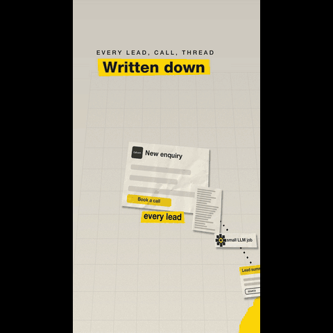
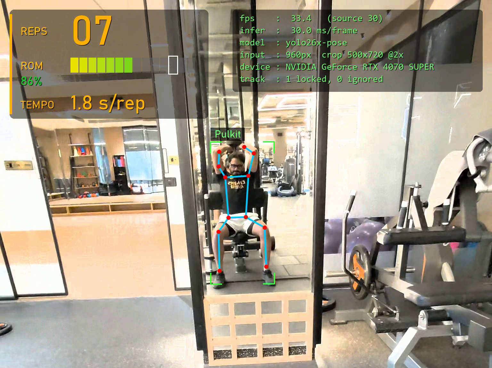
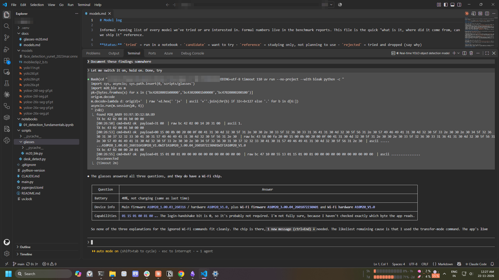
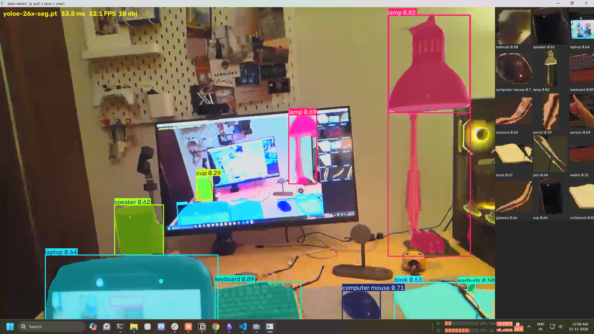

In [one Black Mirror episode](https://www.imdb.com/title/tt2089050/), everyone has a grain behind the ear and every conversation comes with a rewind button.

I watched it years ago as a warning. Lately it reads like a spec sheet.

## The line I already drew

Notion runs my work life.

Fireflies sits in on every call and writes the summary. Small LLM jobs summarize leads, engagements and changes to builds. Everything lands in Notion, and Claude reads it.

My personal life has a database too, but getting into it is much harder. Something only gets logged if I'm actually analyzing it.

[[2026-06-13-why-i-automate|Gym workouts]]. Coffee intake. [[2026-04-12-luna-ios-shortcut|Ideas]]. Things I want to build later.

People stay out. What I want to say to someone and what I want to remember about them both still live in my head.

That has nothing to do with whether I could build it. I could, and I know roughly how long it would take.

## The distance is a weekend

Half the pipeline already exists.

My [[2026-04-11-immich|Immich server]] has already sorted every face in my photo library into people. WhatsApp exports chats. Google Calendar has an API. Contacts sync everywhere. Glasses footage lands on a phone by the end of the day.

Chunk it, embed it, push it into a vector DB. Pull the people, places and events into a knowledge graph so the relationships survive. Put an agent on top and ask it what I was doing on a Tuesday in March.

I build systems like this for clients. The engineering was never the hard part.

The hard part is that nothing in that pipeline asks whether it should exist.

## Text, then voice, now eyes

Text was the first medium we got good at. Prompts, documents, retrieval. It's solved enough to feel routine now.

Voice came next. Luna started as [[2026-04-12-luna-ios-shortcut|voice notes from my phone]], transcribed and filed into Notion, and grew into a [[2026-04-27-luna-v2|multi-agent system]] from there.

Vision was the one I left behind. It was a big part of college. Then language models took over my work and I never went back.

Then my girlfriend bought a pair of Meta glasses.

At the gym today I recorded a set in the mirror through them and ran the footage through YOLO26 pose on my RTX 4070 Super. Thirty milliseconds a frame. Reps, range of motion and tempo, tracked on every rep.

It was a toy. It was also the first time in years a camera felt like an input.

## Three hours, two pairs of cheap glasses

A hardware-obsessed friend handed me two pairs of white-label camera glasses. HeyCyan family, ₹2,000 to ₹4,000 each, the kind that ship with a companion app and a vague promise of "AI".

I wanted the camera without the app. I opened Claude Code and we went looking for a way in.

### The way in

Bluetooth came first. Both pairs expose the same proprietary GATT service for commands. A hobbyist repo for a related model gave us the packet layout: header byte, command, length, CRC-16/MODBUS, payload. We recomputed the CRC on every packet from our own pair. They all matched.

Then the glasses started talking. Battery reports, sent only when the level changes. A media-count event the instant a photo is taken. A volume-state dump on every swipe of the temple. The device-info query gave away a Wi-Fi module inside.

The vendor APK went into jadx. Read only, never run. It answered the real question: photos, video and the live preview travel only over Wi-Fi. BLE carries commands and thumbnails. The preview lives on an RTSP endpoint, and the access point password is hard-coded.

We also wrote down a "never send" list. Firmware update, OTA, auth, delete. Cheap hardware bricks easily.

### The wrong kind of Wi-Fi

We scanned for the glasses as a normal network and found nothing. They use Wi-Fi Direct, so they never show up as an SSID.

The preview command over BLE fixed that. One pair replied within three seconds with its P2P name and password. The other stayed silent. Same-looking hardware, different firmware.

Then a clock started. If no client joins within about 30 seconds, the glasses report a failed connection and switch Wi-Fi off. Our first approach was too slow. Explicit pairing on Windows failed with status 19. Calling `WiFiDirectDevice.from_id_async` directly worked: implicit pairing, no popup, about two seconds.

The PC became group owner at 192.168.137.1. RTSP over TCP gave us 1600×1200 H.264.

### Eyes on

The stream went straight into a YOLOE-26X-seg script on the same 4070 SUPER. A threaded reader keeps only the newest frame, so the detector never falls behind, and reconnects when the stream stalls.

Lamp, laptop, keyboard, mouse, cup, book, earbuds. About 32 detector loops a second.

That 32 is detector throughput. The glasses' real frame rate is still unmeasured.

The battery dropped from 98% to 84% in five minutes of streaming. Roughly half an hour per charge. Nobody is recording their whole life on these. Yet.

### The real target

The GPU was a shortcut. The glasses can't run a model, but a phone can. Glasses to phone over Wi-Fi, the model on the phone, and speech back through the glasses' own speakers.

Put that together and it stops being a desk demo.

<blockquote class="twitter-tweet">
in a fair world, meta glasses would be marketed as eyes for the blind.  and voice agents as literacy for people who can't read.
&mdash; Pulkit Thapar (@pulkitthapar) <a href="https://x.com/pulkitthapar/status/2118391214575935706?ref_src=twsrc%5Etfw">November 5, 2026</a></blockquote> 

What's in front of me. Read this sign. Where are my keys. All of it offline, on glasses that cost less than the phone they talk to.

The second half of that tweet is already [[2026-07-24-dost-ai-intro|Dost]]. The first half is another rabbit hole: battery, latency, safety, and every white-label firmware behaving a little differently. I haven't gone down it yet.

## Rebuilding a day

Connect the glasses, the calendar, the chats and the photo server, and I could rebuild any day I've lived. Where I was, who I saw, what was said, what was on the table in front of me.

That's the episode. I just took the long way there.

The honest part is that I want some of it.

There are errands in my personal life that don't actually need me. There are group chats I would happily read as a three-line summary.

And I miss my grandfather. Immich can already find his face in my library. I want every photo of him that exists, from everywhere it lives, not just my phone.

Each of these is a weekend build. Each one takes a little bit of remembering off my hands.

The grain never made anyone rewind.

I keep debating whether building these makes me less human.

## How far down

I don't know how far this rabbit hole will take me.

A few nights ago, two pairs of glasses were sitting in a drawer. Now one is a live camera feed with a detector on the other end, and the other is a firmware mystery I haven't cracked.

I'm having fun. That was the whole point of [XLR8 Labs](https://xlr8labs.in/?utm_source=thapar25.github.io&utm_medium=blog&utm_campaign=the-entire-history-of-you).

For now, the grain stays in the drawer.
