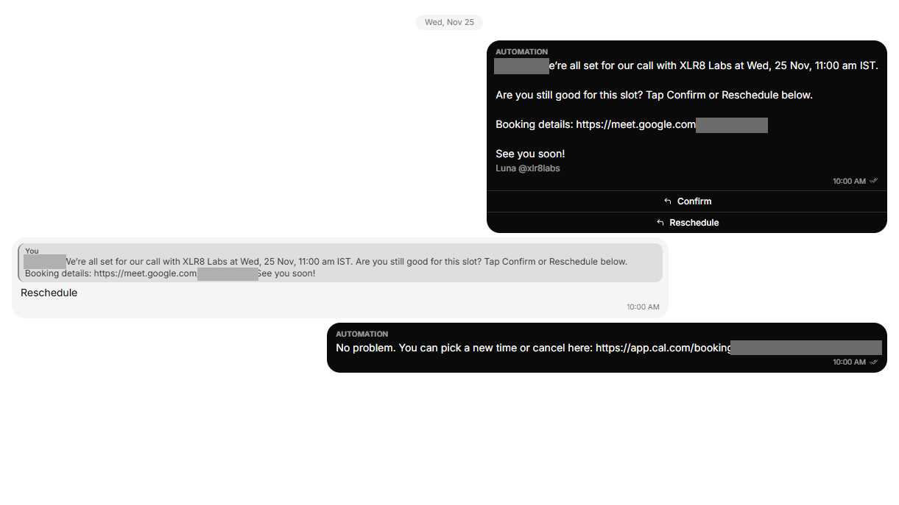
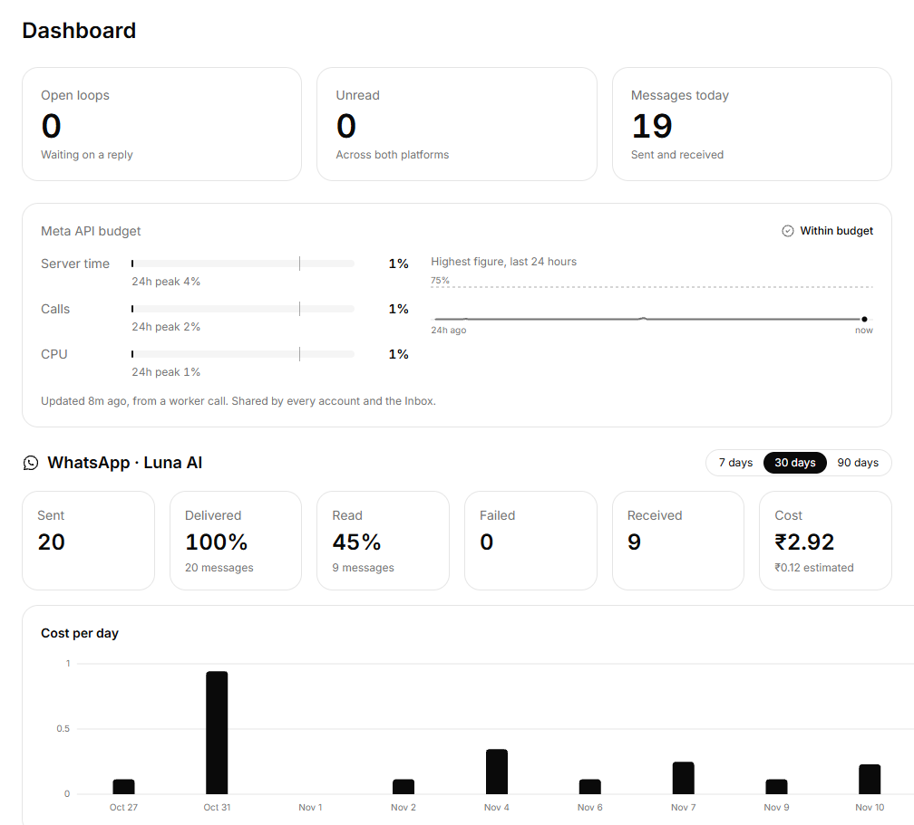
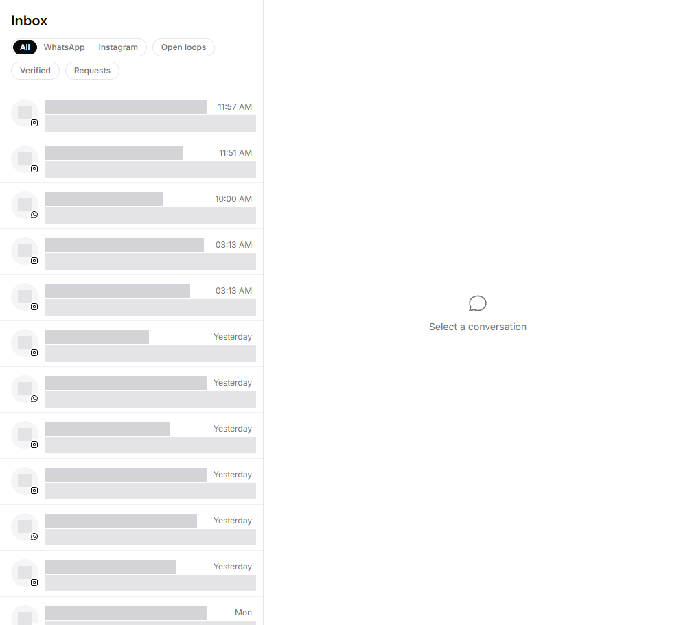
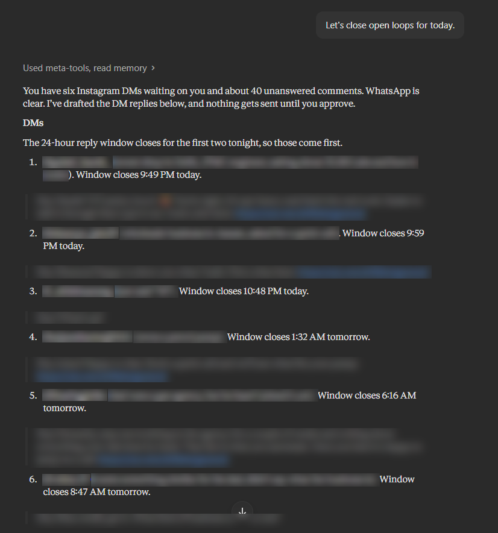
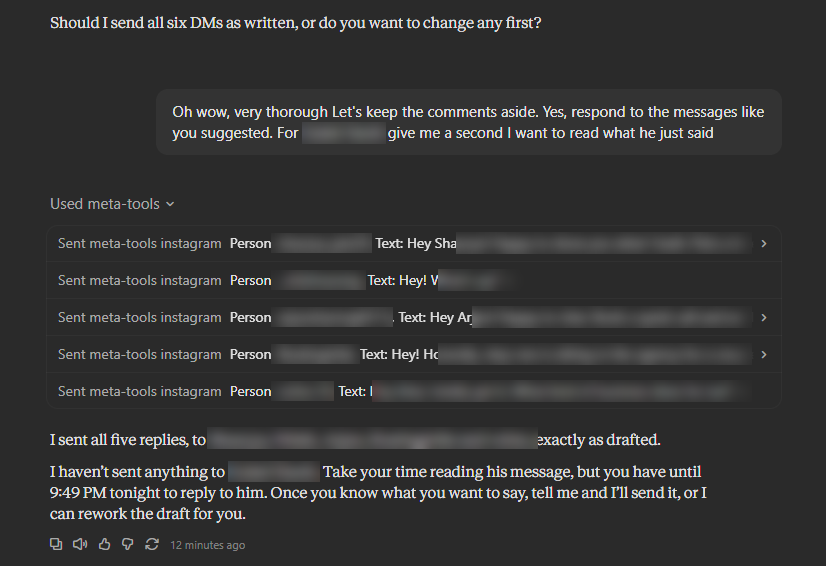
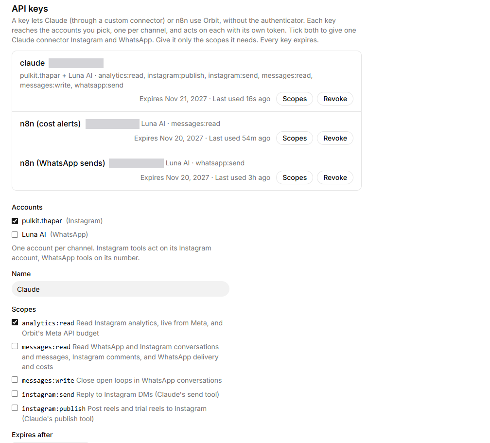

At 10 AM today, a lead tapped Reschedule.

Their 11 AM call moved to 4:30 PM. My morning opened up, and I planned the rest of the day around a call I knew was actually happening.

A month ago, I'd have found out at 11:05.

The confirmation, the tap, and the new booking link all landed inside the same minute. Nobody had to chase anybody.

Thirty days of WhatsApp on the business number cost ₹2.92.

That's what peace of mind costs now.

---

## The Show Rate

[[2026-10-30-seen-by-80000|The last post]] ended on a promise: when there's a show rate, it goes here.

Before the WhatsApp confirmations: 38%.

Since: 93%.

Two people cancelled ahead of time. That's the system working. A cancelled slot is an hour I get back.

One person didn't show. They read the reminder, tapped nothing, and never rebooked.

A reschedule used to be a no-show that hadn't happened yet. Now it's a button.

The dashboard says 45% of messages were read. Treat that as a floor. Anyone with read receipts turned off counts as unread. The number that matters is the one above.

---

## XLR8 Orbit

Most dashboards are built for one kind of user. Orbit is built for two.

XLR8 Orbit is the in-house tool that runs our WhatsApp and Instagram. WhatsApp chats, Instagram DMs and Instagram comments land in one inbox. Swipe right to reply. Right-click to react, quote or copy. Personal WhatsApp contacts stay hidden, so the inbox is only business.

That's the human half.

### Every Button Is a Tool

Orbit ships with its own MCP server. Every action in the UI is also a tool an agent can call: read a thread, reply, react, close the loop on a conversation, pull analytics, publish a reel. If I can click it, Claude can do it.

The web app is one client. The agent is another.

Access runs on API keys. Each key reaches at most one account per channel. Its scopes can change after it's created, an agent only sees the tools its key allows, and every call gets audited.

While I was writing this post, Claude pulled the one no-show's thread through Orbit to check whether the reminder had landed. It had. Delivered, read, ignored.

### One Front Door

Meta's webhooks now hit Orbit first. Orbit forwards every event to n8n untouched, so the three workflows from October never noticed the move.

n8n, the inbox and Claude all send through the same handler. Every message lands in the same thread, tagged by whoever sent it.

Billed WhatsApp costs sync in too, so the spend sits right next to the conversations that caused it. That's where ₹2.92 came from.

A budget tile reads Meta's rate-limit usage straight from its response headers. The inbox, the agents and every account share that limit, so it's worth watching.

### The Boring Parts

Webhooks save the raw event and queue a job. A worker does the processing, with retries and a failed list for anything that gives up. Tokens are encrypted at rest. Every route needs auth by default, and a test enforces it. The tests run on fake secrets and can't reach the internet.

All of it runs on a free-tier Oracle server, the same free tier [[2026-07-24-dost-ai-intro|Dost]] runs on, with the front end on Vercel.

---

The rented number is still waiting for its voice agent.

The volume doesn't need one yet. And before anything speaks to a customer on my behalf, I want to know exactly how it sounds. Today, I make those calls myself. Tomorrow, the option is there.
